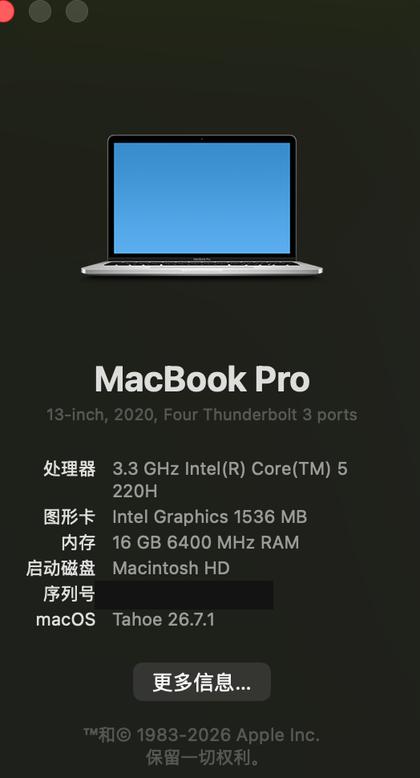

# RedmiBook 14 2025 (Core 5 220H) — macOS Tahoe 26.7.1 Hackintosh

OpenCore configuration for the **Xiaomi RedmiBook 14 2025 (2.8K)**, Intel **Core 5 220H** (Raptor Lake-H), with the **A7AA** Iris Xe iGPU, running **macOS Tahoe 26.7.1 (25G241)** with working **Metal 2**.

This repository documents what works, what does not, and the exact configuration that gets the internal eDP panel and the Xe iGPU accelerated on Tahoe. It intentionally contains **no third-party or Apple kext binaries** — see [docs/KEXTS.md](docs/KEXTS.md) for the download list.

> 中文说明见 [README.zh-CN.md](README.zh-CN.md)。

## Machine

| Item | Value |
|---|---|
| Model | Xiaomi RedmiBook 14 2025 (2.8K) |
| CPU | Intel Core 5 220H (Raptor Lake-H) |
| iGPU | Intel Iris Xe (80 EU), PCI `8086:A7AA` rev `0x04`, subsystem `1d72:2413` |
| Display | Internal eDP only, `TL140ADXP21-0`, 2880×1800 |
| Audio | Realtek ALC256 (`0x10EC0256`), HDA `8086:51CA` |
| Wi-Fi / BT | Intel AX211 CNVi (`8086:51F1` / BT on USB) |
| Fingerprint | FPC sensor (`10A5:9201`, Windows Hello class) |
| Storage | NVMe, APFS |
| SMBIOS | `MacBookPro16,2` |
| Bootloader | OpenCore 1.0.x |

## Status

| Feature | State |
|---|---|
| Internal eDP + Metal 2 | ✅ 1536 MB VRAM, `AppleIntelFramebufferController` + `IntelAccelerator` |
| Wi-Fi (native stack) | ✅ ForbiddenItlwm Tahoe build |
| Bluetooth | ✅ IntelBluetoothFirmware + BlueToolFixup |
| AirDrop / AWDL | ✅ `awdl0`, listener on channel 149 |
| Audio output / input devices | ✅ SimpleHDA + AppleALC (ALC256) |
| Internal microphone | ❌ PDM/DMIC behind Intel SST — not drivable by macOS |
| Apple Music streaming | ❌ FairPlay key request fails on Tahoe (DRM) |
| Touch ID / fingerprint | ❌ FPC sensor, no macOS API outside Apple SEP |
| iPhone Mirroring | ❌ requires Apple silicon / T2 |
| Shutdown power-off | ⚠️ Shuts down but may stay powered with a black screen (needs a long press); see `docs/KNOWN-ISSUES.md` |
| Camera | ✅ UVC (`XiaoMi Webcam`, SunplusIT `2B7E:C900`) |
| Trackpad | ✅ VoodooI2C HID (polling mode, see notes) |

## Notes

- **The internal microphone does not work.** It is a PDM digital microphone wired to the Intel Smart Sound DSP, not to the ALC256 codec, and macOS has no driver for it. macOS still shows a phantom "Internal Microphone" input that records silence; changing AppleALC layouts does not help (it only breaks the speakers). Use a **USB microphone** or a **Bluetooth headset mic**.
- **Apple Music streaming** fails on Tahoe because of FairPlay DRM (local files and Safari audio are fine).
- Fingerprint and iPhone Mirroring need Apple's Secure Enclave (T2/SEP) and cannot work here.

## Screenshot

About This Mac on this build (serial number redacted):



## What is in this repo

```
EFI/OC/config.plist        redacted OpenCore config (SMBIOS serials replaced)
EFI/OC/ACPI/*.aml          ACPI tables used by this build
docs/KEXTS.md              every required kext, version and download link
docs/TAHOE-NOTES.md        Tahoe-specific findings (upgrade, Graphics, audio, Wi-Fi)
docs/KNOWN-ISSUES.md       hardware/DRM limits and their causes
```

## How this machine gets Metal

The upstream WhateverXe 0.8.3 release admits `A7AA` but blocks the native start on this board (`N97NativePreflight = No`, `ADLPFBTCUnavailable = Yes`). Metal was obtained with:

1. **`PciRoot(0x0)/Pci(0x2,0x0)` DeviceProperties applied** — `framebuffer-patch-enable = 01000000`, `framebuffer-stolenmem = 0000C003`. Note: in the original config the whole key was prefixed with `#`, so OpenCore ignored it.
2. **WhateverXe built from `jkbuha/WhateverXe` branch `xps-unified`** (0.8.3 + RPL-P/ADL-H eDP admission patches, also offered upstream in b00t0x/WhateverXe#78 / #125) with boot-arg **`-wex-edp-keep`**.
3. **WhateverXe Graphics 0.4.4 reinstalled after the Tahoe upgrade**, so AuxKC is rebuilt against the new IO80211/IOGraphics ABIs. Skipping this step yields a black screen after the Apple logo.

With those three, the gates flip to `N97NativePreflight = Yes`, `WEXDisplay13TCHooksReady = Yes`, `N97FramebufferBackendReady = Yes`.

## Boot arguments

```
debug=0x100 keepsyms=1 ctrsmt=full -igfxdvmt -allow3d -disablegfxfirmware
-btleadv -itlawdlcoexprobe -itlawdliface -itlawdlnativeup -itlawdlcoexrx
-itlawdlcoextx -itlawdlcoexmulti -itlawdlcoexdata -itlawdlmitx -itlawdlelicit
-itlawdlcaps -itlawdlsvcmerge -itlawdlawsync itlawdlintcoal=4 -itlawdlcoexbatx
-itlawdlcoexpeerpause -itlawdlcoexbatrace itlawdltxqueue=4096
-wex-tc-bootstrap -wex-edp-keep -vi2c-force-polling
```

- `-itlawdl*` / `-btleadv`: ForbiddenItlwm AWDL/AirDrop set (see its BOOT-FLAGS.md).
- `-wex-edp-keep`: jkbuha eDP keep-alive; without it the panel drops to black on the patched build.
- `-vi2c-force-polling`: the Goodix touchpad drops touches in GPIO/APIC mode on this board, polling is stable.
- `-disablegfxfirmware`: required by WhateverXe.

## Usage

1. Install the kexts listed in [docs/KEXTS.md](docs/KEXTS.md) into `EFI/OC/Kexts`.
2. Copy `EFI/OC/config.plist` and `EFI/OC/ACPI/*.aml` into your ESP.
3. **Generate your own SMBIOS**: `PlatformInfo > Generic` serials are placeholders (`XXXXXXXXXXXX`). Use GenSMBIOS for `MacBookPro16,2`.
4. Add `SSDT-PNLF` compatible with your EC if brightness control misbehaves.
5. Install `WhateverXe-Graphics-0.4.4.pkg` after macOS updates (it rebuilds AuxKC).
6. First boot: press `Esc` at the OpenCore picker if you need the boot menu; the config boots macOS directly.

## Credits

- [b00t0x/WhateverXe](https://github.com/b00t0x/WhateverXe) and [WhateverXe-Graphics](https://github.com/b00t0x/WhateverXe-Graphics) — Intel Xe drivers.
- [jkbuha/WhateverXe](https://github.com/jkbuha/WhateverXe) — RPL-P/ADL-H internal eDP patches (`xps-unified`).
- [retropineaple/ForbiddenItlwm](https://github.com/retropineaple/ForbiddenItlwm) — AWDL/AirDrop capable AirportItlwm fork.
- [laobamac/SimpleHDA](https://github.com/laobamac/SimpleHDA) — restores AppleHDA on Tahoe.
- [acidanthera](https://github.com/acidanthera) — OpenCore, Lilu, VirtualSMC, AppleALC, BlueToolFixup.
- [OpenIntelWireless](https://github.com/OpenIntelWireless) — IntelBluetoothFirmware.
- [alexandred/VoodooI2C](https://github.com/VoodooI2C), [acidanthera/VoodooPS2](https://github.com/acidanthera/VoodooPS2).

## License

Documentation and configuration in this repository: MIT. Third-party kexts remain under their own licenses; see [docs/KEXTS.md](docs/KEXTS.md).
