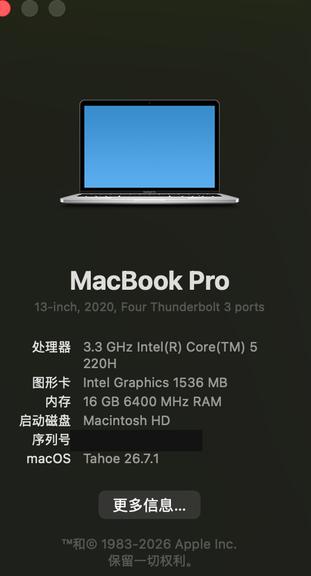

# RedmiBook 14 2025（Core 5 220H）— macOS Tahoe 26.7.1 黑苹果

Xiaomi **RedmiBook 14 2025（2.8K）** 的 OpenCore 配置。Intel **Core 5 220H**（Raptor Lake-H），核显 **A7AA**（Iris Xe），系统为 **macOS Tahoe 26.7.1（25G241）**，**Metal 2 已开启**。

本仓库记录这台机器哪些能用、哪些不能用，以及让内屏 + Xe 核显在 Tahoe 上跑起来的完整配置。**仓库不打包任何第三方或苹果 kext 二进制**，下载清单见 [docs/KEXTS.md](docs/KEXTS.md)。

> English: [README.md](README.md)

## 机型

| 项目 | 值 |
|---|---|
| 型号 | 小米 RedmiBook 14 2025（2.8K） |
| CPU | Intel Core 5 220H（Raptor Lake-H） |
| 核显 | Intel Iris Xe（80 EU），PCI `8086:A7AA` rev `0x04`，子系统 `1d72:2413` |
| 屏幕 | 仅内屏 eDP，`TL140ADXP21-0`，2880×1800 |
| 音频 | Realtek ALC256（`0x10EC0256`），HDA `8086:51CA` |
| Wi-Fi / 蓝牙 | Intel AX211 CNVi（`8086:51F1`，蓝牙走 USB） |
| 指纹 | FPC 传感器（`10A5:9201`，Windows Hello 类） |
| 存储 | NVMe，APFS |
| SMBIOS | `MacBookPro16,2` |
| 引导 | OpenCore 1.0.x |

## 状态

| 功能 | 状态 |
|---|---|
| 内屏 eDP + Metal 2 | ✅ 1536 MB 显存，`AppleIntelFramebufferController` + `IntelAccelerator` 均在 |
| Wi-Fi（原生栈） | ✅ ForbiddenItlwm Tahoe 构建 |
| 蓝牙 | ✅ IntelBluetoothFirmware + BlueToolFixup |
| 隔空投送 / AWDL | ✅ `awdl0`，监听 149 信道 |
| 音频输出 / 输入设备 | ✅ SimpleHDA + AppleALC（ALC256） |
| 内置麦克风 | ❌ PDM/DMIC 走 Intel SST，macOS 无法驱动 |
| Apple Music 流媒体 | ❌ Tahoe 上 FairPlay 取密钥失败（DRM 限制） |
| 指纹 / Touch ID | ❌ FPC 传感器，macOS 无 SEP 之外的指纹接口 |
| iPhone 镜像 | ❌ 需要 Apple 芯片或 T2 |
| 关机断电 | ✅ `SSDT-PTSWAK` + `_PTS/_WAK` 改名 |
| 摄像头 | ✅ UVC（`XiaoMi Webcam`，SunplusIT `2B7E:C900`） |
| 触控板 | ✅ VoodooI2C HID（轮询模式，见注意事项） |

## 备注

- **内置麦克风无法使用。** 这台机器的麦克风是 PDM 数字麦（DMIC），接在 Intel SST（智音技术）上，macOS 没有对应驱动；系统里会出现一个叫「内置麦克风」的输入设备，但录不到声音。换 AppleALC 布局无效（只会把扬声器弄坏）。日常请用 **USB 麦克风** 或 **蓝牙耳机麦克风**。
- Apple Music **流媒体**在 Tahoe 上因 FairPlay 限制无法播放（本地文件、Safari 音频都正常）。
- 指纹、iPhone 镜像需要 Apple 的安全隔区（T2/SEP），本机无解。

## 截图

本机「关于本机」（序列号已打码）：



## 仓库内容

```
EFI/OC/config.plist        已脱敏的 OpenCore 配置（三码已替换）
EFI/OC/ACPI/*.aml          本机使用的 ACPI 表
docs/KEXTS.md              所有 kext 的版本与下载链接
docs/TAHOE-NOTES.md        Tahoe 升级踩坑记录（Graphics、音频、Wi-Fi）
docs/KNOWN-ISSUES.md       硬件/DRM 限制及原因
```

## 这台机器怎么跑出 Metal

上游 WhateverXe 0.8.3 能识别 `A7AA`，但在这块主板上会挡住原生启动（`N97NativePreflight = No`、`ADLPFBTCUnavailable = Yes`）。最终出 Metal 靠三步：

1. **让 `PciRoot(0x0)/Pci(0x2,0x0)` 的 DeviceProperties 真正生效**：`framebuffer-patch-enable = 01000000`、`framebuffer-stolenmem = 0000C003`。原配置里整个键名前面有个 `#`，OpenCore 会直接忽略它。
2. **用 `jkbuha/WhateverXe` 的 `xps-unified` 分支自编译**（0.8.3 + RPL-P/ADL-H 内屏准入补丁，也就是上游 b00t0x/WhateverXe#78 / #125 那份），boot-args 加 **`-wex-edp-keep`**。
3. **升级 Tahoe 后重装 WhateverXe Graphics 0.4.4**，让 AuxKC 按新的 IO80211/IOGraphics ABI 重建。跳过这步就是苹果标志后黑屏。

做完这三步，闸门会变成 `N97NativePreflight = Yes`、`WEXDisplay13TCHooksReady = Yes`、`N97FramebufferBackendReady = Yes`。

## 启动参数

```
debug=0x100 keepsyms=1 ctrsmt=full -igfxdvmt -allow3d -disablegfxfirmware
-btleadv -itlawdlcoexprobe -itlawdliface -itlawdlnativeup -itlawdlcoexrx
-itlawdlcoextx -itlawdlcoexmulti -itlawdlcoexdata -itlawdlmitx -itlawdlelicit
-itlawdlcaps -itlawdlsvcmerge -itlawdlawsync itlawdlintcoal=4 -itlawdlcoexbatx
-itlawdlcoexpeerpause -itlawdlcoexbatrace itlawdltxqueue=4096
-wex-tc-bootstrap -wex-edp-keep -vi2c-force-polling
```

- `-itlawdl*` / `-btleadv`：ForbiddenItlwm 的 AWDL/隔空投送参数集（见其 BOOT-FLAGS.md）。
- `-wex-edp-keep`：jkbuha 补丁版的内屏保持；不加会黑屏。
- `-vi2c-force-polling`：这块 Goodix 触控板在 GPIO/APIC 中断模式下会断触，轮询才稳定。
- `-disablegfxfirmware`：WhateverXe 要求。

## 使用方法

1. 按 [docs/KEXTS.md](docs/KEXTS.md) 把 kext 放进 `EFI/OC/Kexts`。
2. 把 `EFI/OC/config.plist` 和 `EFI/OC/ACPI/*.aml` 拷到 ESP。
3. **自己生成三码**：`PlatformInfo > Generic` 里序列号是占位符（`XXXXXXXXXXXX`），用 GenSMBIOS 生成 `MacBookPro16,2` 的三码。
4. 亮度异常时按需换成与自己 EC 匹配的 `SSDT-PNLF`。
5. 每次 macOS 更新后重装 `WhateverXe-Graphics-0.4.4.pkg`（它会重建 AuxKC）。
6. 首次启动：配置默认直接进 macOS；需要菜单时开机按住 `Esc`。

## 致谢

- [b00t0x/WhateverXe](https://github.com/b00t0x/WhateverXe) 与 [WhateverXe-Graphics](https://github.com/b00t0x/WhateverXe-Graphics) — Intel Xe 驱动
- [jkbuha/WhateverXe](https://github.com/jkbuha/WhateverXe) — RPL-P/ADL-H 内屏补丁（`xps-unified`）
- [retropineaple/ForbiddenItlwm](https://github.com/retropineaple/ForbiddenItlwm) — 支持 AWDL/隔空投送的 AirportItlwm 分支
- [laobamac/SimpleHDA](https://github.com/laobamac/SimpleHDA) — 在 Tahoe 上恢复 AppleHDA
- [acidanthera](https://github.com/acidanthera) — OpenCore、Lilu、VirtualSMC、AppleALC、BlueToolFixup
- [OpenIntelWireless](https://github.com/OpenIntelWireless) — IntelBluetoothFirmware
- [alexandred/VoodooI2C](https://github.com/VoodooI2C)、[acidanthera/VoodooPS2](https://github.com/acidanthera/VoodooPS2)

## 许可

本仓库的文档与配置：MIT。第三方 kext 遵循各自许可，见 [docs/KEXTS.md](docs/KEXTS.md)。
